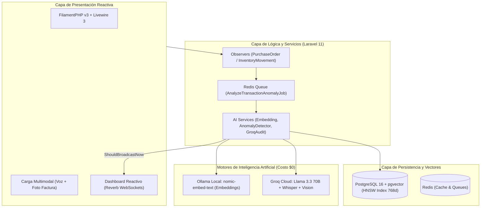

# Sistema ERP de Adquisiciones e Inventarios con Auditoría Operativa IA en Tiempo Real

> **Caso de Estudio:** Importadora y Distribuidora Comercial "Andina S.R.L."  
> **Proyecto Académico Integrado:** Ingeniería de Software 2 | Práctica Empresarial | Preparación y Evaluación de Proyectos (PEP)  
> **Equipo de Desarrollo:** Nataly Nicole Crespo (`NattCrespoC`) & Lucio Mercado

[](https://laravel.com)
[](https://filamentphp.com)
[](https://github.com/pgvector/pgvector)
[](https://laravel.com/docs/11.x/reverb)
[](https://ollama.ai)
[](https://groq.com)
[](https://pestphp.com)

---

## 🎯 Visión y Propuesta de Valor

Los ERPs y sistemas transaccionales tradicionales operan de manera pasiva (CRUD), limitándose a almacenar compras y movimientos de almacén, dejando la detección de irregularidades a auditorías contables manuales de fin de mes. Para entonces, los pagos ya fueron ejecutados y las pérdidas financieras consolidadas.

Este sistema implementa un **auditor autónomo preventivo las 24 horas**. Cada vez que un operador registra una compra o movimiento de almacén:
1. **Vectorización Instantánea (< 30 ms):** Transforma el contexto de la transacción en un vector de 768 dimensiones usando Ollama local (`nomic-embed-text`).
2. **Cálculo Híbrido en PostgreSQL:** Ejecuta en milisegundos la **Distancia de Coseno** ($<=>$) con índice HNSW frente al histórico del proveedor y el índice estadístico de sobreprecio **$Z$-Score**.
3. **Dictamen Inteligente (< 400 ms):** Si la transacción es anómala, la API de Groq genera un dictamen técnico estructurado en JSON detallando el riesgo financiero.
4. **Alerta en Vivo (WebSockets):** Laravel Reverb dispara una alerta visual y sonora al dashboard del Gerente sin recargar la página, reteniendo preventivamente la orden de pago.
5. **Copiloto Gerencial:** La gerencia puede realizar consultas en lenguaje natural mediante **Text-to-SQL de solo lectura** y ejecutar acciones correctivas mediante **Function Calling**.

---

## 🏗️ Arquitectura del Sistema



---

## 🚀 Puesta en Marcha con Podman (Recomendado) o Docker

### 1. Clonar y Configurar Entorno
```bash
git clone git@github.com:NattCrespoC/sistema-erp-auditoria-ia.git
cd sistema-erp-auditoria-ia
cp .env.example .env
```

### 2. Levantar Servicios de Base de Datos y Redis (Multiplataforma)

El proyecto cuenta con scripts nativos tanto para **Linux (Bash)** como para **Windows (PowerShell)**:

**En Linux / macOS:**
```bash
# Levantar PostgreSQL 16 (pgvector) y Redis:
./scripts/podman-up.sh

# O inicializar todo el entorno en un solo paso:
./scripts/run-dev.sh

# Para consultar estado o detener:
./scripts/podman-status.sh
./scripts/podman-down.sh
```

**En Windows (PowerShell con Podman Desktop o Docker Desktop):**
```powershell
# Levantar PostgreSQL 16 (pgvector) y Redis:
.\scripts\podman-up.ps1

# O inicializar todo el entorno en un solo paso:
.\scripts\run-dev.ps1

# Para consultar estado o detener:
.\scripts\podman-status.ps1
.\scripts\podman-down.ps1
```

### 3. Instalar Dependencias de PHP y Node
```bash
composer install
npm install && npm run build
```

### 4. Generar Llave de Aplicación y Migraciones
```bash
php artisan key:generate
php artisan migrate --seed
```

### 5. Descargar Modelo de Vectores en Ollama
```bash
ollama pull nomic-embed-text
```

### 6. Iniciar Servidores de Desarrollo
```bash
# Terminal 1: Servidor HTTP Laravel (Disponible en http://localhost:8000/admin)
php artisan serve --port=8000

# Terminal 2: Servidor WebSocket Reverb
php artisan reverb:start

# Terminal 3: Procesador de Colas de Auditoría Asíncrona
php artisan queue:listen --queue=default,audit
```

---

## 🔑 Credenciales de Acceso para la Demostración

| Rol | Correo Electrónico | Contraseña | Alcance de Evaluación |
| :--- | :--- | :--- | :--- |
| **Gerente General** | `gerente@andina.com` | `password` | Aprobación/Anulación de bloqueos, métricas y Text-to-SQL |
| **Auditor Interno** | `auditor@andina.com` | `password` | Centro de auditoría, dictámenes JSON de Groq y actas PDF |
| **Encargado de Compras** | `compras@andina.com` | `password` | Registro de órdenes de compra maestro-detalle |
| **Jefe de Almacén** | `almacen@andina.com` | `password` | Recepción multimodal de facturas y control de mermas |

> **URL de Acceso:** [`http://localhost:8000/admin`](http://localhost:8000/admin)  
> **Ejecución de Pruebas Unitarias y de Integración (Pest):**  
> `php artisan test` (12 tests / 144 assertions aprobados)

---

## 📁 Entregables Formales y Recursos Gráficos

El proyecto incluye la compilación académica completa en formatos editables y vectoriales:
- 🎓 **Documento de Defensa de Clase (PEP / SOFT 2 / PE):**
  - Word: [`docs/entrega/DOCUMENTO_DEFENSA_CLASE_PEP_SOFT_PE.docx`](docs/entrega/DOCUMENTO_DEFENSA_CLASE_PEP_SOFT_PE.docx) (Cumple la estructura estricta: Título estructurado, Introducción, Antecedentes, 3 problemas medibles, Ishikawa 6M, Causa-Efecto, Objetivo General y 4 Objetivos Específicos con 12 Acciones).
  - PDF: [`docs/entrega/DOCUMENTO_DEFENSA_CLASE_PEP_SOFT_PE.pdf`](docs/entrega/DOCUMENTO_DEFENSA_CLASE_PEP_SOFT_PE.pdf)
- 📊 **Estudio Técnico y Tablas Comparativas de Selección del Stack (PEP & SOFT 2):**
  - Word: [`docs/entrega/ESTUDIO_TECNICO_Y_COMPARATIVAS_ERP_IA.docx`](docs/entrega/ESTUDIO_TECNICO_Y_COMPARATIVAS_ERP_IA.docx) (5 tablas comparativas: Lenguaje, Framework, UI/Admin, BD/Vectores, Modelos IA, Presupuesto por Módulo y Plan de Deploy).
  - PDF: [`docs/entrega/ESTUDIO_TECNICO_Y_COMPARATIVAS_ERP_IA.pdf`](docs/entrega/ESTUDIO_TECNICO_Y_COMPARATIVAS_ERP_IA.pdf)
- 📄 **Documento Maestro del Proyecto (Word):** [`docs/entrega/Proyecto_ERP_Auditoria_IA.docx`](docs/entrega/Proyecto_ERP_Auditoria_IA.docx) (Capítulos 1-5, tablas financieras completas).
- 📕 **Documento Maestro del Proyecto (PDF):** [`docs/entrega/Proyecto_ERP_Auditoria_IA.pdf`](docs/entrega/Proyecto_ERP_Auditoria_IA.pdf)
- 🖼️ **Diagrama de Gantt (Sprints 02-25 Nov):** [`docs/diagrams/01_cronograma_gantt_sprints.png`](docs/diagrams/01_cronograma_gantt_sprints.png).
- 🐟 **Diagrama de Ishikawa (Causa-Efecto):** [`docs/diagrams/02_ishikawa_causa_efecto.png`](docs/diagrams/02_ishikawa_causa_efecto.png).
- 🏛️ **Arquitectura de Componentes Desacoplados:** [`docs/diagrams/03_arquitectura_componentes.png`](docs/diagrams/03_arquitectura_componentes.png).
- 📈 **Modelo Estadístico de Anomalías por Z-Score:** [`docs/diagrams/04_distribucion_anomalias_zscore.png`](docs/diagrams/04_distribucion_anomalias_zscore.png).

---

## 📊 Cronograma de Desarrollo (4 Sprints hasta el 25 de Noviembre)

| Sprint | Fechas | Foco Principal | Responsable |
| :---: | :---: | :--- | :---: |
| **Sprint 1** | 02 - 06 Nov | Cimientos arquitectónicos, PostgreSQL `pgvector`, RBAC y formulación académica. | Dev A & Dev B |
| **Sprint 2** | 07 - 13 Nov | Motor matemático de vectores, integración con Ollama + Groq y Centro de Auditoría. | Dev A & Dev B |
| **Sprint 3** | 14 - 19 Nov | WebSockets con Reverb, Ingesta Multimodal (Voz/Foto) y Copiloto Text-to-SQL. | Dev A & Dev B |
| **Sprint 4** | 20 - 25 Nov | Pruebas de Calidad (PestPHP), estudio financiero PEP (VAN/TIR) y defensa final. | Dev A & Dev B |

---

## 📚 Documentación Técnica Detallada

- [01. Formulación del Problema y Caso de Estudio](docs/01_formulacion_y_caso_de_estudio.md)
- [02. Ingeniería de Software y Casos de Uso](docs/02_ingenieria_de_software_y_casos_de_uso.md)
- [03. Algoritmo Matemático y Pipeline IA](docs/03_algoritmo_matematico_y_pipeline_ia.md)
- [04. Estudio Financiero y Evaluación PEP](docs/04_estudio_financiero_y_evaluacion_pep.md)
- [Reglas del Agente Autónomo (AGENTS.md)](AGENTS.md)
- [Convenciones de Código y Arquitectura (SKILLS.md)](SKILLS.md)
