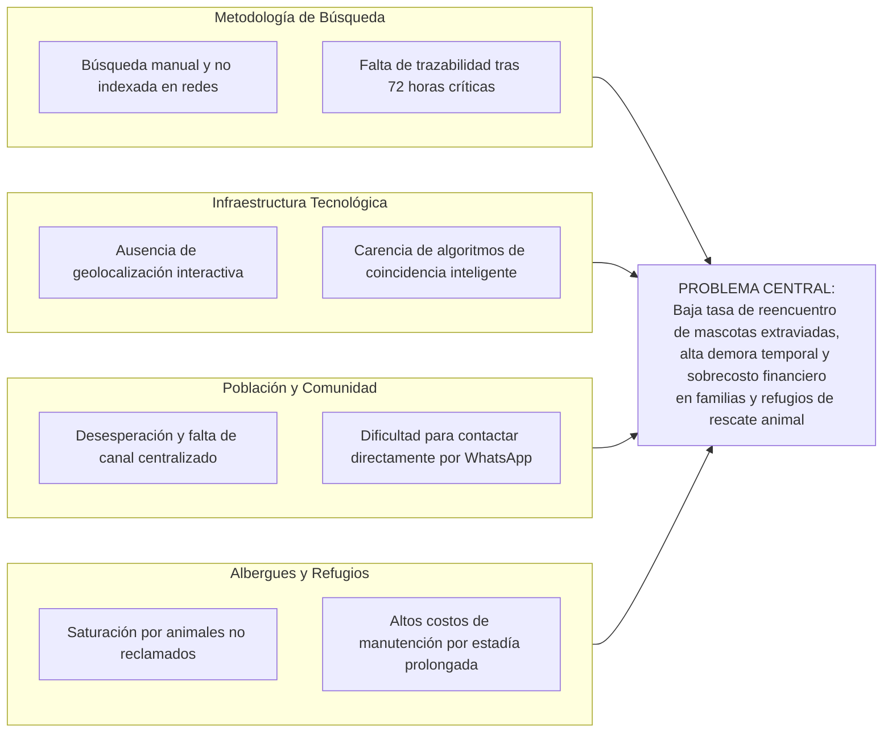

# 01. Formulación del Problema y Caso de Estudio - PETIDENTITY

## Título del Proyecto
**Sistema web colaborativo para el registro, geolocalización y reencuentro de mascotas perdidas y encontradas mediante algoritmos de coincidencia inteligente y visión artificial.**  
*Caso de estudio:* Red Ciudadana y Albergues de Rescate Animal de Cochabamba / Bolivia.

---

## 1. Introducción
La pérdida o extravío de animales de compañía representa un fenómeno de alto impacto social, afectivo y de salud pública en las principales ciudades de Bolivia. La proliferación de mascotas en entornos urbanos no ha estado acompañada de herramientas tecnológicas centralizadas que permitan una respuesta rápida y coordinada ante situaciones de extravío o abandono temporal. En la actualidad, la búsqueda de una mascota perdida descansa casi exclusivamente en la difusión desarticulada de publicaciones en grupos de redes sociales (Facebook, WhatsApp), la impresión de carteles en postes y la peregrinación física por centros de zoonosis y albergues de rescate.

Esta dispersión informativa genera una grave asimetría: mientras un ciudadano angustiado busca a su perro en una zona de la ciudad, otro vecino o rescatista puede haber encontrado al mismo animal a pocas cuadras de distancia sin tener conocimiento mutuo. La falta de un índice geográfico y de un motor analítico que cruce rasgos físicos específicos (especie, color, tamaño, señas particulares) y proximidad espacial provoca que la mayoría de los casos queden sin resolver, terminando en la sobrepoblación y colapso de los albergues de rescate o en el incremento de fauna urbana en situación de calle.

El presente proyecto plantea el desarrollo de **PETIDENTITY**, una plataforma web moderna desarrollada bajo el framework **Laravel 11**, contenedorizada en **Podman** e integrada con geolocalización libre mediante **Leaflet.js + OpenStreetMap** y un motor de coincidencia inteligente multicriterio (`PetMatcherService`). La plataforma articula los estándares de rigor metodológico de **Ingeniería de Software 2**, el impacto social directo requerido en **Práctica Empresarial**, y la evaluación de viabilidad económica y social exigida en **Preparación y Evaluación de Proyectos (PEP)**.

---

## 2. Antecedentes
En el ámbito urbano boliviano, las iniciativas orientadas a la protección animal han dependido tradicionalmente del voluntariado y de organizaciones no gubernamentales que operan con recursos limitados. Plataformas comerciales extranjeras de registro de mascotas suelen requerir suscripciones en moneda extranjera o implantes de microchip RFID con lectores propietarios que no están estandarizados en el medio local.

En el caso específico del departamento de Cochabamba y el eje metropolitano, se estima que más de 50 grupos comunitarios en redes sociales publican diariamente decenas de avisos de animales extraviados o encontrados. No obstante, al carecer de una estructura de base de datos normalizada, los avisos quedan enterrados por el algoritmo de las redes en cuestión de horas. La carencia de un sistema unificado y con georreferenciación precisa perpetúa el ciclo de extravío y abandono.

---

## 3. Formulación del Problema (Tres Problemas Medibles)

### 1. Problema Medible en Tiempo (Demora en el Reencuentro y Localización)
En el ecosistema informal de búsqueda en redes sociales, el tiempo promedio que transcurre desde que una mascota se extravía hasta que se logra establecer contacto con quien la encontró oscila entre **18 y 35 días calendario**. Durante este lapso, el animal corre el riesgo de sufrir accidentes de tránsito, contraer enfermedades o ser trasladado a distritos lejanos, disminuyendo exponencialmente la probabilidad de reencuentro tras las primeras 72 horas críticas.

### 2. Problema Medible en Cantidad (Volumen de Mascotas sin Recuperar)
De acuerdo con registros muestrales de colectivos de rescate animal en el área metropolitana, de un promedio estimado de **280 reportes mensuales** de mascotas extraviadas, aproximadamente el **68% (190 mascotas al mes)** nunca regresa a su hogar. Un alto porcentaje de estos animales termina ingresando a albergues temporales que ya operan a más del **140% de su capacidad instalada**, provocando hacinamiento y saturación logística.

### 3. Problema Medible en Costo (Impacto Económico en Familias y Refugios)
La dispersión en la búsqueda impone un costo económico significativo:
- Las familias afectadas destinan en promedio entre **Bs. 250 y Bs. 600** en impresión de afiches, fotocopias y movilización en los primeros 10 días.
- Para los albergues y centros de acogida, la manutención, atención veterinaria básica y alimentación de cada animal no reclamado representa un costo recurrente de aproximadamente **Bs. 450 mensuales por mascota**. La imposibilidad de conectar oportunamente a las mascotas encontradas con sus dueños legítimos genera una sobrecarga presupuestaria evitable superior a **Bs. 85.000 anuales** por cada 20 animales retenidos innecesariamente.

---

## 4. Pregunta Central de Investigación
> *¿De qué manera el desarrollo de un sistema web colaborativo con geolocalización interactiva y motor de coincidencia inteligente multicriterio permitirá reducir el tiempo de localización, incrementar la tasa de reencuentro de mascotas extraviadas y mitigar los costos de búsqueda y manutención en albergues de la ciudad de Cochabamba?*

---

## 5. Diagrama de Causa - Efecto (Ishikawa)

---

## 6. Objetivos del Proyecto

### Objetivo General
Desarrollar e implementar un sistema web colaborativo y reactivo (**PETIDENTITY**) basado en Laravel 11 y Podman, dotado de geolocalización con mapas libres y un motor de coincidencia multicriterio basado en proximidad geográfica y rasgos fenotípicos, para facilitar el registro, identificación y reencuentro oportuno de mascotas perdidas y encontradas.

### Objetivos Específicos
1. Diseñar y construir una arquitectura modular y desacoplada mediante contenedores **Podman** con Laravel 11, base de datos relacional y almacenamiento seguro de imágenes.
2. Implementar un módulo de geolocalización interactiva mediante **Leaflet.js y OpenStreetMap**, permitiendo a los ciudadanos fijar con un clic las coordenadas exactas del extravío o hallazgo sin depender de APIs de pago.
3. Desarrollar un motor de análisis de coincidencias (**`PetMatcherService`**) que aplique la fórmula esférica de Haversine y ponderaciones de similitud de rasgos físicos (especie, raza, colores, tamaño) para sugerir emparejamientos automáticos entre reportes opuestos (`lost` vs `found`).
4. Proveer un canal de contacto directo y seguro vía **WhatsApp y telefonía** dentro de la ficha de detalle de cada mascota para agilizar la coordinación ciudadana.
5. Evaluar la viabilidad económica, técnica y operativa del sistema bajo los criterios académicos de Preparación y Evaluación de Proyectos (PEP) e Ingeniería de Software 2.

---

## 7. Justificación del Proyecto

- **Justificación Técnica:** El proyecto demuestra la aplicación de arquitectura moderna de software: contenedores independientes con Podman, tipado estricto PHP 8.4, patrones de diseño Service/Action, consumo de mapas libres sin costes recurrentes y algoritmos matemáticos determinísticos de cálculo de distancia esférica.
- **Justificación Práctica y Operativa:** Permite a cualquier ciudadano reportar una mascota encontrada en cuestión de segundos desde su teléfono móvil sin requerir la instalación de aplicaciones nativas pesadas, georreferenciando el hallazgo de forma visual.
- **Justificación Económica (PEP):** Reduce drásticamente los gastos familiares en afiches físicos y alivia el costo operativo de manutención en albergues al acelerar la restitución del animal a su núcleo familiar.
- **Justificación Social:** Fortalece la cultura de protección animal, reduce los peligros asociados a la fauna urbana desprotegida y promueve la solidaridad vecinal organizada.
