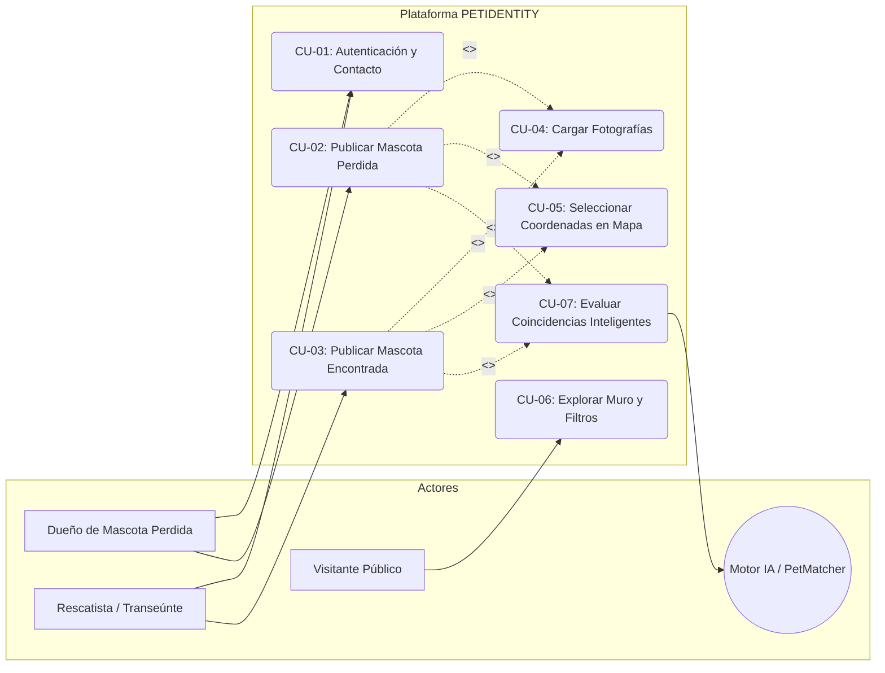
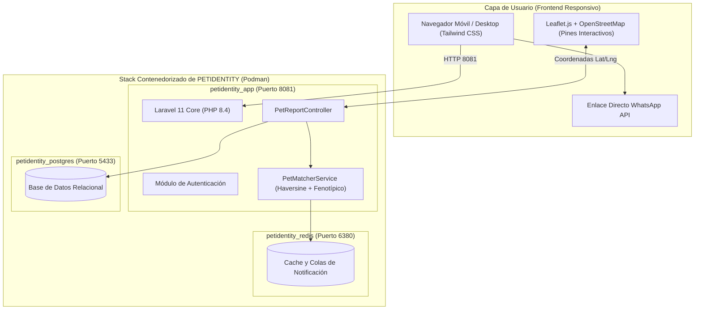
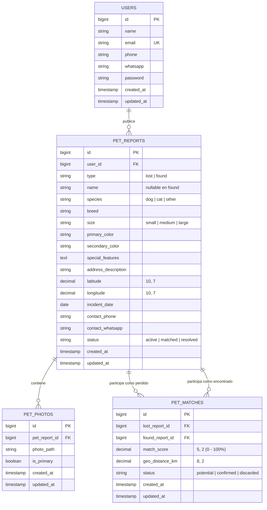

# 02. Ingeniería de Software, Casos de Uso y Modelo de Datos - PETIDENTITY

---

## 1. Especificación de Requisitos del Sistema

### Requisitos Funcionales (RF)
- **RF-01 (Gestión de Cuentas y Contacto Directo):** El sistema debe permitir a los ciudadanos registrarse e iniciar sesión de manera segura, solicitando de forma obligatoria su número de teléfono o WhatsApp para facilitar el contacto inmediato en caso de coincidencias.
- **RF-02 (Registro de Mascota Perdida):** El sistema debe proveer un formulario para que los propietarios registren a su mascota extraviada, incluyendo: nombre, especie (perro, gato, otro), raza, tamaño (pequeño, mediano, grande), color principal, color secundario, señas particulares o collar, fecha del extravío y ubicación geográfica.
- **RF-03 (Registro de Mascota Encontrada):** El sistema debe ofrecer un formulario simplificado y rápido para que los transeúntes o rescatistas que encuentren un animal en la vía pública puedan reportarlo de inmediato, omitiendo el nombre y enfocándose en los rasgos físicos visibles y la ubicación exacta del hallazgo.
- **RF-04 (Carga y Almacenamiento de Fotografías):** El sistema debe admitir la subida de una o varias fotografías de la mascota en formatos estándar (JPG, PNG, WebP) con validación de peso y enlace público accesible (`storage:link`).
- **RF-05 (Geolocalización Interactiva con Leaflet.js):** El sistema debe integrar un mapa interactivo basado en OpenStreetMap y Leaflet.js sin requerir claves de API de pago, permitiendo al usuario seleccionar con un solo clic o arrastre las coordenadas exactas (`latitude` y `longitude`) y la zona/barrio textual.
- **RF-06 (Muro Público y Filtros de Búsqueda):** El sistema debe proveer una galería pública interactiva que permita filtrar los reportes activos por tipo (`Perdidas`, `Encontradas`, `Todas`), especie, tamaño y color, además de un mapa general con marcadores codificados por color (rojo/naranja para perdidas, verde/azul para encontradas).
- **RF-07 (Motor de Coincidencias Inteligentes - `PetMatcherService`):** Cada vez que se registre o consulte un reporte, el sistema debe cruzar automáticamente los datos contra los reportes activos del tipo opuesto, calculando un porcentaje de afinidad (`match_score` de 0% a 100%) combinando distancia geográfica (Haversine) y compatibilidad de rasgos físicos.
- **RF-08 (Ficha de Detalle y Enlace de Contacto WhatsApp):** En la vista de detalle de cada mascota, el sistema debe mostrar su ficha completa, su ubicación en el mapa, un botón de contacto directo hacia WhatsApp con mensaje predeterminado y una sección destacada con las **"Posibles Coincidencias Detectadas por IA"** ordenadas por porcentaje de compatibilidad.

### Requisitos No Funcionales (RNF)
- **RNF-01 (Rendimiento y Latencia):** El cálculo de coincidencias y renderizado de la ficha de detalle no debe superar los **300 ms** para listas de hasta 1.000 reportes activos.
- **RNF-02 (Cero Costes de Licenciamiento en Mapas):** La solución de cartografía debe operar 100% sobre capas libres de OpenStreetMap y bibliotecas Open Source (Leaflet.js), sin depender de cuotas ni cobros de Google Maps API.
- **RNF-03 (Diseño Adaptativo / Mobile-First):** La interfaz construida en Blade y Tailwind CSS debe ser completamente responsiva, permitiendo una experiencia fluida desde smartphones tanto para rescatistas en la calle como para usuarios de escritorio.
- **RNF-04 (Seguridad e Integridad de Datos):** Las contraseñas deben estar cifradas mediante `bcrypt`, las operaciones con archivos deben sanitizar los nombres de imagen para evitar Path Traversal, y las consultas a base de datos deben utilizar sentencias preparadas mediante Eloquent ORM.

---

## 2. Catálogo Detallado de Casos de Uso

| Código | Caso de Uso | Actor Principal | Propósito / Descripción Breve |
| :--- | :--- | :--- | :--- |
| **CU-01** | Autenticación y Perfil | Ciudadano / Rescatista | Registro, inicio de sesión y gestión de número de WhatsApp para contacto. |
| **CU-02** | Reportar Mascota Perdida | Dueño de Mascota | Publicar reporte con foto, rasgos detallados y ubicación del extravío. |
| **CU-03** | Reportar Mascota Encontrada | Transeúnte / Albergue | Reporte ágil de animal avistado o rescatado en vía pública. |
| **CU-04** | Carga de Fotografías | Usuario Autenticado | Subir y asociar imágenes a los reportes para su reconocimiento visual. |
| **CU-05** | Marcado en Mapa Leaflet | Usuario Autenticado | Ubicar geográficamente el suceso mediante un pin interactivo arrastrable. |
| **CU-06** | Galería Pública y Filtros | Visitante / Ciudadano | Explorar reportes con filtros por estado, especie, color y mapa general. |
| **CU-07** | Detección de Coincidencias | Motor del Sistema | Evaluación automática de compatibilidad multicriterio entre reportes opuestos. |

---

## 3. Diagrama General de Casos de Uso (Mermaid)

---

## 4. Diagrama de Arquitectura de Contenedores (Podman)

---

## 5. Modelo Entidad - Relación (MER en Mermaid)

