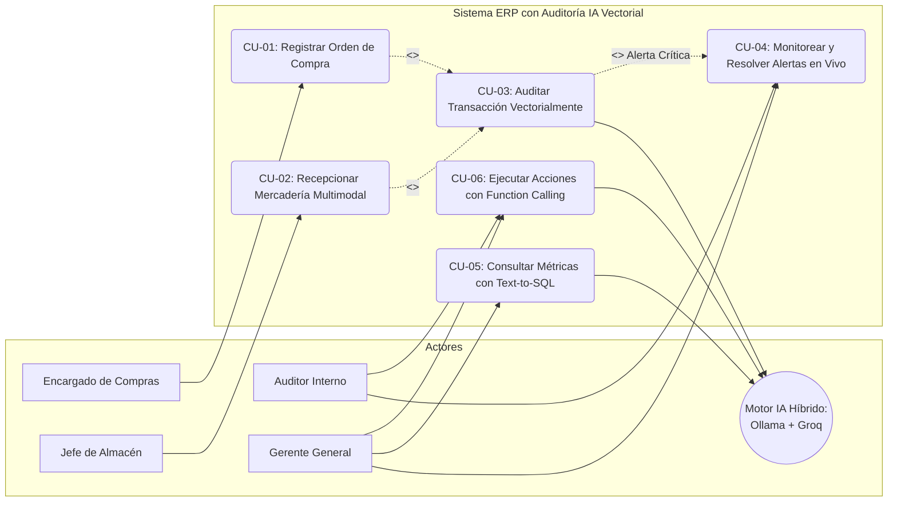
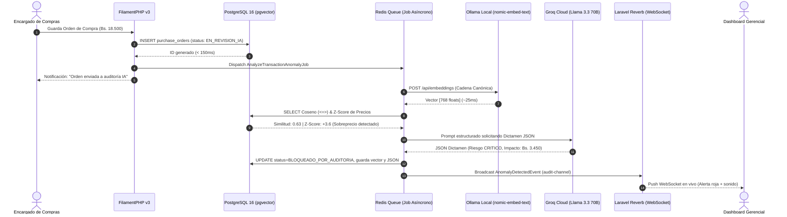
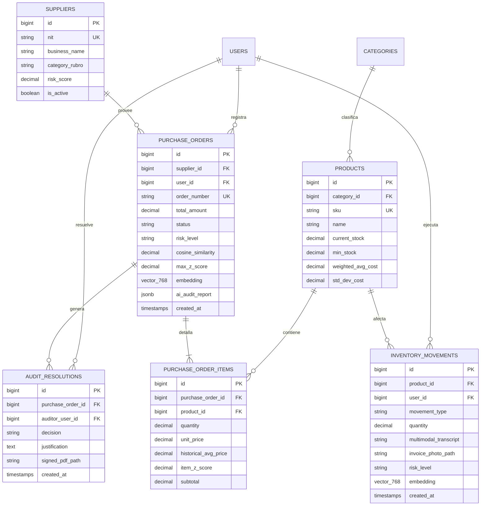

# 02. Ingeniería de Software y Especificación de Casos de Uso

---

## 1. Requisitos del Sistema

### Requisitos Funcionales (RF)
- **RF-01 (Gestión de Órdenes de Compra):** El sistema debe permitir registrar, listar, editar y auditar órdenes de compra compuestas por maestro (proveedor, fecha, forma de pago) y detalle (productos, cantidades, precios unitarios).
- **RF-02 (Ingesta Multimodal de Almacén):** El sistema debe recibir imágenes de comprobantes físicos y notas de voz, procesándolas mediante OCR y Whisper para precompletar el formulario de ingreso físico.
- **RF-03 (Vectorización Automática Asíncrona):** El sistema debe interceptar cada orden de compra o movimiento de inventario para normalizar su contenido y generar su vector de 768 dimensiones vía Ollama en segundo plano.
- **RF-04 (Cálculo Estadístico y Vectorial):** El sistema debe computar en PostgreSQL la distancia de coseno frente al histórico del proveedor/categoría y el $Z$-Score por cada producto, determinando un nivel de riesgo (`BAJO`, `MEDIO`, `ALTO`, `CRITICO`).
- **RF-05 (Bloqueo Preventivo y Dictamen IA):** Si el riesgo es `ALTO` o `CRITICO`, el sistema debe cambiar el estado de la transacción a `BLOQUEADO_POR_AUDITORIA` y solicitar un dictamen en JSON estructurado a Groq API.
- **RF-06 (Alertas en Tiempo Real por WebSockets):** El sistema debe emitir eventos mediante Laravel Reverb para que las pantallas de los directivos se actualicen en menos de 1 segundo sin recargar el navegador.
- **RF-07 (Copiloto Text-to-SQL de Solo Lectura):** El sistema debe permitir a la gerencia realizar preguntas analíticas en lenguaje natural y ejecutar sentencias SQL seguras tipo `SELECT`.
- **RF-08 (Acciones Administrativas con Function Calling):** El sistema debe permitir al auditor aprobar excepciones justificadas o anular compras bloqueadas con generación automática de actas PDF firmadas con QR.

### Requisitos No Funcionales (RNF)
- **RNF-01 (Latencia del Pipeline):** El tiempo total del ciclo de auditoría (despacho + vectorización en Ollama + consulta SQL + Groq + Reverb) no debe superar los 2.000 ms.
- **RNF-02 (Tiempo de Respuesta HTTP):** La interfaz de usuario debe responder en menos de 250 ms al persistir una transacción, delegando el cómputo de IA a Redis Queues.
- **RNF-03 (Seguridad de Consultas):** El motor Text-to-SQL debe conectarse exclusivamente a través de un usuario de PostgreSQL con permisos `GRANT SELECT`, denegando cualquier comando DDL/DML de modificación.
- **RNF-04 (Trazabilidad e Inmutabilidad):** Todo cambio de estado de una transacción retenida debe quedar registrado en una bitácora inmutable con usuario, fecha, hora, IP y justificación.

---

## 2. Diagrama de Casos de Uso General (Mermaid)

---

## 3. Especificación Expandida de Casos de Uso Críticos

### CU-01 & CU-03: Registro y Auditoría Vectorial de Orden de Compra
- **Actores:** Encargado de Compras (Primario), Motor IA (Secundario).
- **Precondiciones:** Sesión iniciada con rol `compras`; proveedor y productos vigentes en el catálogo.
- **Flujo Principal:**
  1. El usuario ingresa a *Órdenes de Compra*, selecciona el proveedor y agrega los ítems mediante el repeater maestro-detalle.
  2. Presiona *Guardar Orden*.
  3. El sistema guarda el registro con estado `EN_REVISION_IA` y libera la pantalla en menos de 200 ms.
  4. `PurchaseOrderObserver` despacha el trabajo `AnalyzeTransactionAnomalyJob` a la cola Redis.
  5. El Job concatena la cadena canónica y solicita el vector de 768 floats a Ollama local (`nomic-embed-text`).
  6. Se ejecuta la consulta en PostgreSQL con `pgvector` calculando la similitud de coseno y el $Z$-Score de cada producto.
  7. Si la similitud $\ge 0.80$ y $|Z| \le 2.0$, la orden pasa a estado `APROBADA` con riesgo `BAJO`.
- **Flujo Alternativo (Anomalía Crítica):**
  - 7a. Si la similitud $< 0.80$ o $|Z| > 2.0$, se marca riesgo `CRITICO` y estado `BLOQUEADO_POR_AUDITORIA`.
  - 7b. El Job invoca la API de Groq (`llama-3.3-70b-versatile`) con salida JSON estructurada.
  - 7c. Se guarda el dictamen en la columna `ai_audit_report` y se emite `AnomalyDetectedEvent` vía Laravel Reverb.
  - 7d. La pantalla de los directivos despliega la notificación en vivo con sonido y detalles del sobreprecio.

---

## 4. Diagrama de Secuencia del Proceso de Auditoría

---

## 5. Diagrama de Arquitectura de Base de Datos (ERD)

