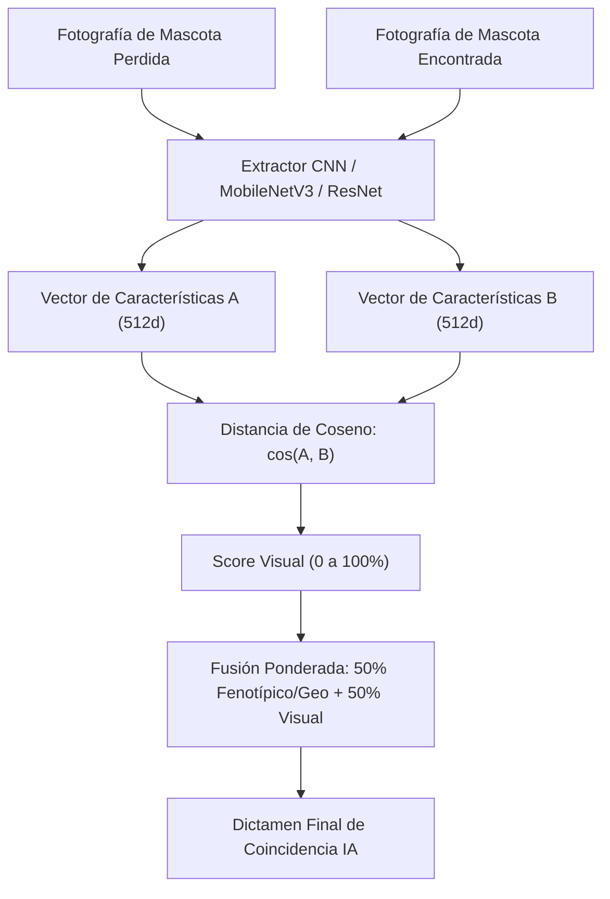

# 03. Algoritmo Matemático de Coincidencias y Pipeline de IA - PETIDENTITY

---

## 1. Fundamentación Matemática del Motor de Emparejamiento (`PetMatcherService`)

El objetivo central del motor de coincidencias de **PETIDENTITY** consiste en evaluar y clasificar cuantitativamente la probabilidad de que una mascota reportada como **Perdida (`lost`)** corresponda a un animal reportado como **Encontrado (`found`)**. Para lograr este propósito con alto rendimiento y sin requerir entrenamiento continuo de modelos pesados en la Iteración 1, se implementa un **algoritmo de similitud híbrido multicriterio** que combina:
1. Proximidad geográfica sobre superficie esférica (Fórmula de Haversine).
2. Similitud fenotípica estandarizada (Especie, Raza, Tamaño, Colores).
3. Interfaz desacoplada para la integración del vector de visión artificial (Iteración 2).

---

## 2. Componente de Proximidad Geográfica (Fórmula de Haversine)

Dado que las coordenadas de los reportes se capturan en grados decimales de Latitud ($\varphi$) y Longitud ($\lambda$), la distancia en línea recta en el plano euclidiano introduce errores significativos debido a la curvatura terrestre. Por ello, se aplica rigurosamente la **Fórmula de Haversine**:

$$\Delta \varphi = \varphi_2 - \varphi_1 \quad (\text{en radianes})$$
$$\Delta \lambda = \lambda_2 - \lambda_1 \quad (\text{en radianes})$$

$$a = \sin^2\left(\frac{\Delta \varphi}{2}\right) + \cos(\varphi_1) \cdot \cos(\varphi_2) \cdot \sin^2\left(\frac{\Delta \lambda}{2}\right)$$

$$c = 2 \cdot \arctan2\left(\sqrt{a}, \sqrt{1 - a}\right)$$

$$d_{\text{km}} = R \cdot c$$

Donde:
- $R = 6.371\text{ km}$ (Radio medio de la Tierra).
- $d_{\text{km}}$ representa la distancia ortodrómica en kilómetros entre ambos reportes.

### Función de Ponderación por Distancia Geográfica ($S_{\text{geo}} \in [0, 30]$ pts)
La probabilidad de que una mascota se desplace grandes distancias decrece de manera exponencial con el tiempo y el radio urbano:

| Rango de Distancia ($d_{\text{km}}$) | Puntos Otorgados ($S_{\text{geo}}$) | Justificación Operativa |
| :---: | :---: | :--- |
| **$d \le 1.0\text{ km}$** | **30.0 pts** | Mismo barrio o cuadrante vecinal inmediato. |
| **$1.0 < d \le 3.0\text{ km}$** | **24.0 pts** | Radio de caminata habitual en zonas urbanas. |
| **$3.0 < d \le 6.0\text{ km}$** | **18.0 pts** | Desplazamiento interbarrial o cruce de avenidas. |
| **$6.0 < d \le 12.0\text{ km}$** | **10.0 pts** | Límite distrital en la mancha metropolitana. |
| **$12.0 < d \le 25.0\text{ km}$** | **4.0 pts** | Desplazamiento vehicular o traslado involuntario. |
| **$d > 25.0\text{ km}$** | **0.0 pts** | Distancia improbable para animales de compañía. |

---

## 3. Componente de Similitud Fenotípica y Rasgos Físicos

### A. Filtro Inviolable de Especie ($S_{\text{esp}} \in \{0, 1\}$)
La especie actúa como compuerta lógica determinística:
$$S_{\text{esp}} = \begin{cases} 1 & \text{si } \text{especie}_A = \text{especie}_B \\ 0 & \text{si } \text{especie}_A \neq \text{especie}_B \end{cases}$$
Si un reporte corresponde a un perro y otro a un gato, el puntaje total se anula de inmediato ($Score = 0\%$).

### B. Similitud de Tamaño Corporal ($S_{\text{tam}} \in [0, 15]$ pts)
Los tamaños se ordenan en una escala discreta: `small (1)`, `medium (2)`, `large (3)`.
- Si los tamaños coinciden exactamente: **15 pts**.
- Si son tamaños adyacentes (ej. `small` vs `medium` por margen de apreciación del rescatista): **8 pts**.
- Si son opuestos (`small` vs `large`): **0 pts**.

### C. Similitud de Colores ($S_{\text{col}} \in [0, 15]$ pts)
Se evalúa la concordancia de color primario y secundario:
- Coincidencia exacta de color primario: **10 pts**.
- Coincidencia de color secundario (o color primario con secundario): **5 pts**.

### D. Coincidencia de Raza ($S_{\text{raza}} \in [0, 10]$ pts)
- Si ambas razas son idénticas o una es `Mestizo`/`Cruza`: **10 pts**.
- Si existe similitud fonética o textual normalizada: **5 pts**.
- Razas incompatibles declaradas: **0 pts**.

### E. Bonificación por Señas Particulares y Metadatos ($S_{\text{señas}} \in [0, 30]$ pts)
En la Iteración 1, se evalúa la coincidencia de palabras clave en el texto descriptivo (collar, mancha, oreja caída, cola corta, cicatriz, etc.) otorgando hasta 30 pts, dejando el espacio reservado para la inferencia visual de la Iteración 2.

---

## 4. Fórmula Global de Similitud Multicriterio

El puntaje consolidado de compatibilidad ($Score_{\text{match}}$) se calcula mediante la combinación lineal normalizada:

$$Score_{\text{match}} = S_{\text{esp}} \times \min\left(100, \, S_{\text{geo}} + S_{\text{tam}} + S_{\text{col}} + S_{\text{raza}} + S_{\text{señas}}\right)$$

### Umbrales de Clasificación para la Demostración:
- **$\ge 80\%$ (ALTA COMPATIBILIDAD):** Se despliega con badge verde esmeralda y recomendación de contacto prioritario vía WhatsApp.
- **$50\% \le Score < 80\%$ (COMPATIBILIDAD MEDIA):** Se despliega con badge amarillo ámbar como posible coincidencia para revisión visual.
- **$< 50\%$ (BAJA COMPATIBILIDAD):** No se destaca en la sección principal para evitar falsos positivos y sobrecarga cognitiva.

---

## 5. Pipeline de Visión por Computadora (Planificado para Iteración 2)

