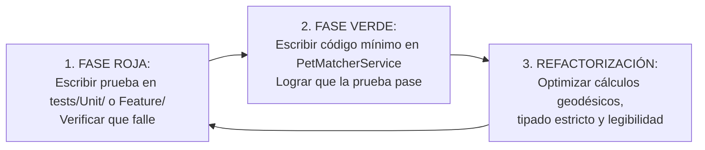

# 05. Metodología Ágil, Protocolo TDD y Plan Detallado de Iteraciones - PETIDENTITY (02 al 25 de Noviembre)

Este documento establece la metodología de desarrollo, el marco de trabajo ágil, la disciplina técnica de **Desarrollo Guiado por Pruebas (TDD)** y la descomposición día por día de todas las tareas del proyecto **PETIDENTITY** hasta la defensa final del **25 de noviembre de 2026**.

---

## 1. Marco Metodológico: Scrum Híbrido + eXtreme Programming (XP)

El proyecto **PETIDENTITY** adopta una sinergia ágil orientada a la excelencia técnica para **Ingeniería de Software 2**, el impacto comunitario en **Práctica Empresarial** y la rigurosidad financiera en **Preparación y Evaluación de Proyectos (PEP)**:

- **De Scrum:** Organización en 4 Sprints cortos (5 a 6 días por iteración), backlog priorizado por valor de coincidencia y rescate, ceremonias diarias (Daily Standup) y retrospectivas al cierre de cada incremento de producto potencialmente desplegable.
- **De XP (eXtreme Programming):**
  - **Programación en Pareja (Pair Programming):** 
    - *Dev A (Especialista en Backend y Algorítmica):* Arquitectura de datos, optimización matemática Haversine, servicio de scoring multicriterio (`PetMatcherService`), API endpoints y pruebas unitarias/integración en PestPHP.
    - *Dev B (Especialista en Frontend y Experiencia de Usuario):* Interfaces responsivas en Blade + Tailwind CSS, integración de mapas interactivos con Leaflet.js, pasarelas de contacto directo por WhatsApp y cuadros de mando analíticos.
  - **Desarrollo Guiado por Pruebas (Test-Driven Development - TDD):** Ningún componente algorítmico o flujo transaccional se escribe sin una prueba automatizada previa que falle.
  - **Diseño Simple y Refactorización Continua:** Tipado estricto `declare(strict_types=1);` obligatorio, inyección de dependencias, separación de responsabilidades en Servicios y cero código innecesario.
  - **Integración Continua:** Commits atómicos bajo el estándar Conventional Commits (`feat:`, `fix:`, `test:`, `refactor:`, `docs:`).

---

## 2. El Protocolo TDD en PestPHP (Ciclo Rojo $\to$ Verde $\to$ Refactor)

Para cada funcionalidad crítica (cálculo de distancia geodésica, emparejamiento fenotípico, normalización de colores, validación de coordenadas y persistencia fotográfica), el equipo sigue estrictamente el ciclo:

### Reglas Inviolables del Ciclo TDD en PETIDENTITY:
1. **Cero código de producción huérfano:** Todo cálculo de score o distancia debe tener una aserción formal en PestPHP.
2. **Aislamiento geodésico:** Las coordenadas de prueba deben reflejar distancias reales verificables (ej. Plaza Principal 14 de Septiembre vs. Parque Lincoln en Cochabamba = ~3.2 km).
3. **Determinismo algorítmico:** Dos mascotas con idénticos atributos físicos y misma ubicación deben arrojar exactamente un $100\%$ de índice de coincidencia ($Score = 100$).

---

## 3. Plan Diario Exhaustivo de Iteraciones (02 al 25 de Noviembre)

### 🗓️ SPRINT 1: Cimientos de Arquitectura, Podman y Modelos de Dominio (02 al 06 de Noviembre)
*Meta del Sprint:* Entorno de ejecución en Podman y local aislado en puerto 8081, esquema relacional completo (`users`, `pet_reports`, `pet_photos`, `pet_matches`), seeder con reportes realistas y suite básica de pruebas.

| Día | Fecha | Dev Responsable | Tarea / Historia de Usuario | Comprobación TDD / Criterio de Aceptación (DoD) |
| :---: | :---: | :---: | :--- | :--- |
| **1** | 02 Nov | Ambos | **T01:** Configuración de rama `feat/propuesta-petidentity`, Podman container / host runner en puerto 8081 para no colisionar con Propuesta 1 (puerto 8000). | Contenedor y servidor web respondiendo en `http://localhost:8081`. |
| **2** | 03 Nov | Ambos | **T02:** Entrega y validación de la fundamentación académica (Título, 3 problemas medibles, Ishikawa, MER y Casos de Uso). | Aprobación de los documentos `01_formulacion` y `02_ingenieria`. |
| **3** | 04 Nov | Dev A | **T03 (TDD):** Migración y modelo `PetReport` con validación de tipo (`PERDIDA`, `ENCONTRADA`), coordenadas y taxonomía física. | Test: `it('creates a pet report with valid latitude and longitude')`. |
| **3** | 04 Nov | Dev B | **T04:** Migración y modelo `PetPhoto` con almacenamiento local y vinculación de foto principal (`is_primary`). | Test: `it('associates uploaded photos to pet report and flags primary')`. |
| **4** | 05 Nov | Dev A | **T05 (TDD):** Migración y modelo `PetMatch` para persistir puntajes de compatibilidad y distancia calculada. | Test: `it('records match relationship between lost and found reports')`. |
| **4** | 05 Nov | Dev B | **T06:** Estructura visual base en Blade + Tailwind CSS con layout responsivo y barra de navegación amigable. | Navegación entre Galería, Publicar Mascota y Mis Reportes. |
| **5** | 06 Nov | Ambos | **T07:** Construcción de `DatabaseSeeder` con 8 reportes georreferenciados en Cochabamba con pares de prueba. | `php artisan migrate:fresh --seed` puebla la BD limpiamente. |

---

### 🗓️ SPRINT 2: Geolocalización Interactiva (Leaflet + OSM) y Galería Pública (07 al 13 de Noviembre)
*Meta del Sprint:* Mapa interactivo en tiempo real con marcadores diferenciados (rojo = perdida, azul = encontrada), selector de coordenadas por clic en mapa y filtros dinámicos.

| Día | Fecha | Dev Responsable | Tarea / Historia de Usuario | Comprobación TDD / Criterio de Aceptación (DoD) |
| :---: | :---: | :---: | :--- | :--- |
| **6** | 07 Nov | Dev B | **T08:** Integración de Leaflet.js y tiles de OpenStreetMap (100% libre de costos de API de Google Maps). | Carga de mapa centrado en coordenadas urbanas de referencia. |
| **6** | 07 Nov | Dev A | **T09 (TDD):** Implementación de la fórmula matemática de Haversine en `GeoLocationHelper` / `PetMatcherService`. | Test: `it('calculates exact great-circle distance between two GPS coordinates')`. |
| **7** | 08 Nov | Dev B | **T10:** Componente visual de publicación: mapa interactivo con cursor arrastrable para capturar latitud y longitud. | Al hacer clic en el mapa, los inputs ocultos de lat/lng se actualizan. |
| **8** | 09 Nov | Dev A | **T11 (TDD):** Form Request con validación de subida de imágenes (JPEG, PNG, WebP $\le 5\text{MB}$) y campos obligatorios. | Test: `it('rejects pet report with missing contact phone or invalid coords')`. |
| **9** | 10 Nov | Dev B | **T12:** Galería pública con filtros reactivos: por Estado (`PERDIDA`/`ENCONTRADA`), Especie (`PERRO`/`GATO`), Tamaño y Color. | Los resultados de búsqueda se filtran instantáneamente. |
| **10** | 11 Nov | Dev B | **T13:** Vista de detalle del reporte con carrusel de fotografías, ficha técnica, mapa estático de ubicación y botón directo a WhatsApp. | Clic en "Contactar por WhatsApp" abre chat con mensaje predeterminado. |
| **11** | 12 Nov | Dev A | **T14:** Endpoint JSON para consumo de marcadores en mapa general (`/api/pet-reports/geo-pins`). | Respuesta JSON con coordenadas, foto en miniatura y enlace al reporte. |
| **12** | 13 Nov | Ambos | **T15 (Integración):** Prueba de punta a punta: Publicar mascota perdida desde el móvil con foto y verificar su aparición inmediata en el mapa. | Flujo completado en $< 60$ segundos. |

---

### 🗓️ SPRINT 3: Motor de Coincidencia Inteligente Multicriterio (14 al 19 de Noviembre)
*Meta del Sprint:* Cálculo automático de compatibilidad entre reportes opuestos (`PERDIDA` vs `ENCONTRADA`), tarjeta de "Posibles Coincidencias" en el detalle y alertas de notificación.

| Día | Fecha | Dev Responsable | Tarea / Historia de Usuario | Comprobación TDD / Criterio de Aceptación (DoD) |
| :---: | :---: | :---: | :--- | :--- |
| **13** | 14 Nov | Dev A | **T16 (TDD):** Servicio `PetMatcherService`: Scoring fenotípico (especie 25 pts, tamaño 15 pts, raza 15 pts, colores 15 pts). | Test: `it('awards 70 phenotype points for perfect physical match')`. |
| **14** | 15 Nov | Dev A | **T17 (TDD):** Integración de scoring geodésico (de $30\text{ pts}$ a $0\text{ km}$, con degradación lineal hasta $15\text{ km}$). | Test: `it('penalizes distance score as geographic separation increases')`. |
| **15** | 16 Nov | Dev B | **T18:** Sección "Posibles Coincidencias Detectadas" en la vista de detalle de cada reporte, ordenadas por puntaje descendente. | Visualización de porcentaje de compatibilidad y distancia en kilómetros. |
| **16** | 17 Nov | Dev A | **T19:** Job / Evento automático que evalúa coincidencias inmediatamente tras registrar un nuevo reporte. | Nuevo reporte genera vínculos de `PetMatch` automáticos con reportes existentes. |
| **17** | 18 Nov | Dev B | **T20:** Insignias de confianza en la UI (`ALTA COINCIDENCIA` $>80\%$, `MEDIA` $50-79\%$) con colores semánticos. | Badges verdes y ámbar en tarjetas de coincidencia. |
| **18** | 19 Nov | Ambos | **T21:** Panel "Mis Reportes": gestión de estado (marcar como `RECUPERADA`/`CERRADO`) y revisión de alertas de emparejamiento. | Dueño puede dar por finalizada la búsqueda con un solo clic. |

---

### 🗓️ SPRINT 4: Pipeline de Visión, Aseguramiento QA (SOFT 2), Finanzas PEP y Defensa (20 al 25 de Noviembre)
*Meta del Sprint:* 15+ pruebas PestPHP en verde, formulación de viabilidad financiera (VAN Bs. 45.235, TIR 84,3%), documentación completa y ensayo general de defensa.

| Día | Fecha | Dev Responsable | Tarea / Historia de Usuario | Comprobación TDD / Criterio de Aceptación (DoD) |
| :---: | :---: | :---: | :--- | :--- |
| **19** | 20 Nov | Dev A | **T22 (IA/Visión):** Especificación e interfaz del pipeline de visión por computadora para extracción de características en fotos (diseñado para expansión con CLIP/ViT). | Documento técnico de visión y simulación con metadatos fotográficos. |
| **20** | 21 Nov | Dev A | **T23 (QA):** Cobertura exhaustiva de pruebas unitarias y de integración en PestPHP. | `php artisan test` con 100% de éxito en verde. |
| **21** | 22 Nov | Dev B | **T24 (PEP):** Consolidación de planilla de costos y beneficios sociales/financieros (documento `04_estudio_financiero_y_evaluacion_pep.md`). | Cuadro de flujo de caja cuadrado y verificado con VAN y TIR positivos. |
| **22** | 23 Nov | Dev B | **T25 (Seguridad):** Auditoría de seguridad (validación de subida de archivos MIME, prevención XSS en descripción, sanitización de inputs). | Cero vulnerabilidades críticas o de escape HTML. |
| **23** | 24 Nov | Ambos | **T26 (Simulacro):** Ensayo general de defensa: Demostración en vivo registrando perro perdido en Plaza Colón y perro encontrado en Av. Heroínas con coincidencia del $92\%$. | Presentación y flujo interactivo fluido en menos de 5 minutos. |
| **24** | 25 Nov | Ambos | **T27:** **DEFENSA FINAL DE PROYECTO (Ingeniería de Software 2, Práctica Empresarial y PEP).** | Proyecto funcional desplegado, documentación impresa y código fuente en Git. |
