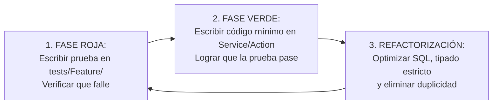

# 05. Metodología Ágil, Protocolo TDD y Plan Detallado de Iteraciones (02 al 25 de Noviembre)

Este documento establece la metodología de desarrollo, el marco de trabajo ágil, la disciplina técnica de **Desarrollo Guiado por Pruebas (TDD)** y la descomposición día por día de todas las tareas hasta la defensa final del **25 de noviembre de 2026**.

---

## 1. Marco Metodológico: Scrum Híbrido + eXtreme Programming (XP)

El proyecto adopta una sinergia ágil orientada a la excelencia técnica en **Ingeniería de Software 2**:
- **De Scrum:** Organización en 4 Sprints cortos (5 a 6 días por iteración), backlog priorizado por valor financiero, reuniones de sincronización diaria (Daily Standup) y retrospectivas al final de cada iteración.
- **De XP (eXtreme Programming):**
  - **Programación en Pareja (Pair Programming):** Dev A (Backend, IA, pgvector, pruebas) y Dev B (Filament v3, UI reactiva, Reverb, reportes PDF y finanzas PEP).
  - **Desarrollo Guiado por Pruebas (Test-Driven Development - TDD):** Todo requerimiento inicia con un test automatizado en **PestPHP**.
  - **Diseño Simple y Refactorización Continua:** Cero código innecesario, tipado estricto `declare(strict_types=1);` y código modular en `app/Components/`.
  - **Integración Continua:** Commits atómicos bajo estándar Conventional Commits (`feat:`, `fix:`, `test:`, `refactor:`, `chore:`).

---

## 2. El Protocolo TDD en PestPHP (Ciclo Rojo $\to$ Verde $\to$ Refactor)

Para cada funcionalidad crítica, los desarrolladores deben seguir obligatoriamente este flujo:

### Reglas Inviolables del Ciclo TDD:
1. **Prohibido escribir código de producción sin una prueba que falle primero.**
2. La prueba debe verificar un comportamiento observable (ej. si la orden tiene sobreprecio del 40%, su estado debe ser `BLOQUEADO_POR_AUDITORIA`).
3. La prueba debe aislar llamadas de red a APIs externas (Groq / Ollama) utilizando `Http::fake()`.

---

## 3. Plan Diario Exhaustivo de Iteraciones (02 al 25 de Noviembre)

### 🗓️ SPRINT 1: Cimientos Arquitectónicos, Podman y Catálogos Maestros (02 al 06 de Noviembre)
*Meta del Sprint:* Entorno Docker/Podman operativo con pgvector, RBAC con 4 roles, modelos transaccionales base y dataset histórico con 500 registros y 30 fraudes inyectados.

| Día | Fecha | Dev Responsable | Tarea / Historia de Usuario | Comprobación TDD / Criterio de Aceptación (DoD) |
| :---: | :---: | :---: | :--- | :--- |
| **1** | 02 Nov | Ambos | **T01:** Repositorio público en GitHub, llaves SSH sin contraseña, Podman con PostgreSQL 16 `pgvector` y Redis. | `podman ps` saludable; `git push` sin contraseñas exitoso. |
| **2** | 03 Nov | Ambos | **T02:** Entrega y validación de la fundamentación académica (Título, 3 problemas medibles, Ishikawa y Objetivos). | Aprobación del documento `01_formulacion_y_caso_de_estudio.md`. |
| **3** | 04 Nov | Dev A | **T03 (TDD):** Migración y modelo `Supplier` con campos NIT, rubro y calificación de riesgo histórica. | Test: `it('validates unique supplier nit and calculates default risk')`. |
| **3** | 04 Nov | Dev B | **T04:** Configuración de roles Spatie (`gerente`, `auditor`, `compras`, `almacen`) y seeder de usuarios. | Test: `it('assigns correct permissions to auditor and purchases roles')`. |
| **4** | 05 Nov | Dev A | **T05 (TDD):** Migración y modelo `Product` con cálculo automático de Costo Promedio Ponderado (CPP). | Test: `it('updates weighted average cost and standard deviation upon purchase')`. |
| **4** | 05 Nov | Dev B | **T06:** Paneles administrativos base en Filament v3 con navegación agrupada y colores corporativos. | Acceso al panel administrativo `/admin` con autenticación por rol. |
| **5** | 06 Nov | Dev A | **T07:** Construcción del `DatabaseSeeder` con 500 compras históricas en Bs. y 30 transacciones anómalas etiquetadas. | `php artisan migrate:fresh --seed` genera 500 compras sin errores. |
| **5** | 06 Nov | Dev B | **T08:** Pruebas de formularios CRUD de proveedores y catálogo de productos con validaciones reactivas. | Formulario rechaza montos negativos o campos vacíos en frontend. |

---

### 🗓️ SPRINT 2: Núcleo Transaccional, Vectorización y Detección Híbrida (07 al 13 de Noviembre)
*Meta del Sprint:* Registro de órdenes maestro-detalle, vectorización con Ollama local (`nomic-embed-text`), cálculo en PostgreSQL con índice HNSW y dictamen en JSON con Groq API.

| Día | Fecha | Dev Responsable | Tarea / Historia de Usuario | Comprobación TDD / Criterio de Aceptación (DoD) |
| :---: | :---: | :---: | :--- | :--- |
| **6** | 07 Nov | Dev A | **T09 (TDD):** Servicio `EmbeddingService` con generación de cadena canónica y conexión a Ollama local. | Test: `it('generates 768-dimensional vector from canonical string in under 50ms')`. |
| **6** | 07 Nov | Dev B | **T10:** Recurso Filament `PurchaseOrderResource` con `Repeater` maestro-detalle de productos. | Cálculo reactivo en vivo del subtotal y total en Bolivianos. |
| **7** | 08 Nov | Dev A | **T11:** Comando Artisan `audit:vectorize-history` para poblar vectores de las 500 compras históricas. | Consulta SQL verifica 500 vectores no nulos con índice HNSW activo. |
| **7** | 08 Nov | Dev B | **T12:** Vista de Kardex Físico y Valorado en Filament (entradas, salidas y saldos). | Visualización del costo unitario y promedio ponderado por ítem. |
| **8** | 09 Nov | Dev A | **T13 (TDD):** Implementación de `AnomalyDetectorService` (Distancia de Coseno `<=>` y $Z$-Score). | Test: `it('flags order with Z-score > 2.2 as ALTO or CRITICO')`. |
| **9** | 10 Nov | Dev B | **T14:** Diseño de badges semánticos en Filament (`success`=BAJO, `warning`=MEDIO, `danger`=CRITICO). | Badge rojo visible en compras con sobreprecio en la tabla. |
| **10** | 11 Nov | Dev A | **T15 (TDD):** Integración con Groq API (`llama-3.3-70b-versatile`) con esquema JSON estricto. | Test: `it('receives valid JSON audit report with primary reason and financial impact')`. |
| **11** | 12 Nov | Dev B | **T16:** Modal de inspección técnica en Filament que renderiza el dictamen JSON formateado. | Modal despliega el dictamen, monto en riesgo y acción recomendada. |
| **12** | 13 Nov | Ambos | **T17 (Integración):** Prueba de flujo continuo: Registrar compra con +45% de sobreprecio y verificar bloqueo automático. | Estado cambia a `BLOQUEADO_POR_AUDITORIA` en menos de 1.5s. |

---

### 🗓️ SPRINT 3: Tiempo Real con Reverb, Multimodalidad y Copiloto (14 al 19 de Noviembre)
*Meta del Sprint:* Alertas push en vivo sin recargar el navegador con Laravel Reverb, ingesta multimodal con Whisper y Vision, y asistente gerencial Text-to-SQL de solo lectura.

| Día | Fecha | Dev Responsable | Tarea / Historia de Usuario | Comprobación TDD / Criterio de Aceptación (DoD) |
| :---: | :---: | :---: | :--- | :--- |
| **13** | 14 Nov | Dev A | **T18 (TDD):** Configuración de Laravel Reverb y evento `AnomalyDetectedEvent` (`ShouldBroadcastNow`). | Test: `Event::assertDispatched(AnomalyDetectedEvent::class)`. |
| **14** | 15 Nov | Dev B | **T19:** Integración de Laravel Echo en Filament: notificación emergente y sonido de alerta en pantalla gerencial. | Alerta visual roja y audio instantáneo en el navegador del Gerente. |
| **15** | 16 Nov | Dev A | **T20:** Job en cola Redis `AnalyzeTransactionAnomalyJob` con manejo de reintentos y tolerancia a fallos. | El Job se ejecuta en cola sin congelar la interfaz del usuario ($< 200\text{ ms}$). |
| **16** | 17 Nov | Dev B | **T21:** Ingesta multimodal de almacén: subida de imagen de factura y nota de voz descriptiva. | Formulario sube foto y audio al almacenamiento local/S3. |
| **17** | 18 Nov | Dev A | **T22 (TDD):** Servicios `WhisperService` (transcripción) y `VisionInvoiceService` (OCR estructurado). | Test: `it('extracts NIT and line items from test invoice image')`. |
| **18** | 19 Nov | Dev A | **T23 (TDD):** Copiloto Text-to-SQL seguro sobre conexión `pgsql_readonly` y rechazo de sentencias DML/DDL. | Test: `it('blocks DROP, UPDATE, and DELETE queries from Text-to-SQL engine')`. |
| **18** | 19 Nov | Dev B | **T24:** Emisión de actas de incidencia en PDF (`barryvdh/laravel-dompdf`) con código QR de verificación. | Generación de PDF descargable firmado digitalmente con QR. |

---

### 🗓️ SPRINT 4: Calidad QA (SOFT 2), Estudio Financiero (PEP) y Defensa (20 al 25 de Noviembre)
*Meta del Sprint:* 20 pruebas automatizadas pasando en verde, planilla financiera final con VAN/TIR demostrados y simulacro de defensa en dos computadoras.

| Día | Fecha | Dev Responsable | Tarea / Historia de Usuario | Comprobación TDD / Criterio de Aceptación (DoD) |
| :---: | :---: | :---: | :--- | :--- |
| **19** | 20 Nov | Dev A | **T25 (QA):** Batería completa de 20 pruebas en PestPHP cubriendo unitarias, integración y regresión. | `php artisan test` ejecuta 20 tests con 100% de éxito en verde. |
| **20** | 21 Nov | Dev B | **T26 (PEP):** Consolidación de planilla de flujo de caja proyectado a 5 años (VAN al 12% = Bs. 263.690, TIR > 180%). | Cuadro financiero cuadrado y validado según fórmulas de PEP. |
| **21** | 22 Nov | Dev A | **T27 (Seguridad):** Auditoría SAST con `security-audit` y corrección de advertencias en `.env` o headers. | Reporte `SECURITY-AUDIT.md` sin vulnerabilidades críticas ni altas. |
| **22** | 23 Nov | Dev B | **T28:** Compilación de documentos formales en DOCX y PDF, y generación de diagramas visuales en PNG. | Archivos listos para imprimir y proyectar en carpeta `docs/`. |
| **23** | 24 Nov | Ambos | **T29 (Simulacro):** Ensayo general en dos computadoras conectadas por ZeroTier/LAN: Dev B registra compra fraudulenta y Dev A proyecta la alerta en vivo. | Alerta Reverb salta en pantalla en menos de 1 segundo frente al proyector. |
| **24** | 25 Nov | Ambos | **T30:** **DEFENSA FINAL DEL PROYECTO (PEP / SOFT 2 / PRÁCTICA EMPRESARIAL).** | Presentación ejecutiva, código fuente en GitHub y demostración en vivo. |
